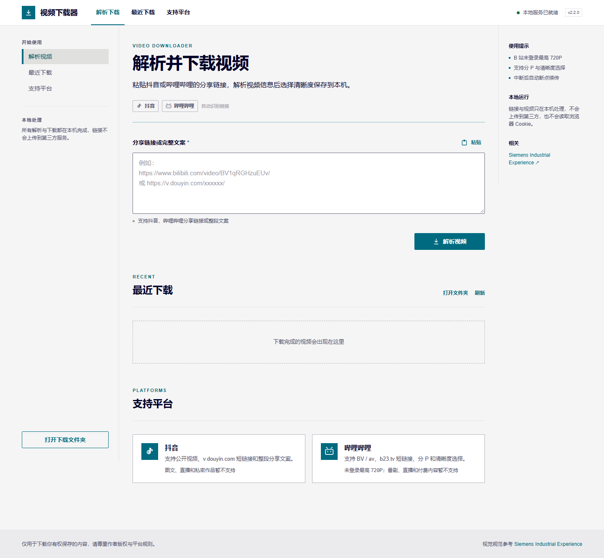

# 抖音 / 哔哩哔哩视频下载器

一个使用 TypeScript 编写、完全在本机运行的视频下载工具。支持 Windows、macOS、Linux 桌面端，下载文件夹后即可启动，无需预先安装 Node.js 或 npm 依赖。贴入链接即可解析标题、作者、封面和清晰度，选择后保存到电脑。

## 功能

- 支持 **哔哩哔哩**：`BV` / `av` 链接、`b23.tv` / `bili2233.cn` 短链接、分 P 视频、多种清晰度。
- 支持 **抖音**：`v.douyin.com` 短链接、完整分享文案、`douyin.com/video/...` 链接。
- **全平台启动器**：Windows / macOS / Linux 自动检测 Node.js，必要时下载便携版，双击即可使用。
- 粘贴整段中文分享文案也能自动找出链接，并自动判断平台。
- 解析后先预览封面、标题、作者、时长和播放量，再选择分 P 和清晰度下载。
- 下载前自动测试多条 CDN 线路并选择最快线路；线路中断时自动切换备用线路。
- 显示下载进度、速度和剩余时间，可以随时取消；已下载部分会保留。
- 下载中断后保留 `.part` 临时文件，下次下载相同视频时自动续传。
- 所有文件保存在项目的 `downloads` 文件夹，网页里可以预览、另存或打开文件夹。

## 项目结构

```text
src/       本地 HTTP 服务、B 站 / 抖音解析与下载引擎
public/    前端页面、样式与交互
scripts/   Windows / macOS / Linux 启动引导与便携 Node.js 下载
docs/      界面截图
downloads/ 下载输出目录（内容不提交到 Git）
```

仓库不会提交下载的视频、临时文件或便携版 Node.js 运行时。

## 界面风格

界面采用 [Siemens Industrial Experience](https://ix.siemens.io/docs/home/overview) 的 **brand light** 主题：`#f5f5f5` 页面、`#fff` 卡片、`#006b80` 主色、`#000028` 文字，Siemens Sans / Arial 字体、2px 直角组件与 1px 边框，不使用渐变和阴影。



## 跨平台启动

下载并解压整个文件夹后，按系统选择启动方式：

| 系统 | 启动方式 |
| --- | --- |
| Windows | 双击 `start.bat` |
| macOS | 双击 `start-macos.command` |
| Linux | 终端执行 `./start-linux.sh`，或 `bash start-linux.sh` |

启动器会优先使用系统已安装的 **Node.js 22.18+**。如果没有安装或版本过低，第一次启动会自动下载官方便携版 Node.js 24.18.0 到 `.runtime`（约 40–60 MB，需要联网），之后可以离线启动。下载失败时会自动尝试国内镜像。

支持 64 位 Windows（x64 / ARM64）、macOS（Intel / Apple Silicon）和 Linux（x64 / ARM64）。文件夹需要放在可写目录中，首次启动需要网络。

> 使用期间请保持启动窗口开启；关闭窗口会停止本地服务。

如果 macOS 提示无法打开 `.command`：右键选择“打开”，或执行 `chmod +x start-macos.command`；也可以直接在终端运行 `bash start-macos.command`。
如果 Linux 提示没有执行权限：执行 `chmod +x start-linux.sh`，或直接运行 `bash start-linux.sh`。

## 使用流程

1. 用上面的方式启动，浏览器通常会自动打开 `http://127.0.0.1:3210`；如果没有打开，请手动访问该地址。
2. 粘贴链接或分享文案，点击“解析视频”。
3. 确认识别出的视频信息，选择清晰度 / 分 P，点击“开始下载”。
4. 完成后点击“保存到电脑”，或者直接在 `downloads` 文件夹中找到视频。

不需要安装 npm 依赖、Python、Go 或 FFmpeg。程序只在本机运行，退出启动窗口即可停止。

## 开发者启动

已经安装 Node.js 22.18+ 时，也可以直接使用 npm 启动：

```bash
npm start
```

Windows 也可使用 `npm.cmd start`。然后手动打开 <http://127.0.0.1:3210>。也可以设置端口：

```powershell
$env:PORT = 3211
npm.cmd start
```

macOS / Linux 对应写法为 `PORT=3211 npm start`。

## 支持的链接示例

```text
https://www.bilibili.com/video/BV1qRGHzuEUv/
https://www.bilibili.com/video/BV1qRGHzuEUv/?p=2
https://b23.tv/xxxxxxx
https://www.douyin.com/video/7xxxxxxxxxxxxxxxxxx
https://v.douyin.com/xxxxxxx/
7.43 复制打开抖音，看看【作者的作品】... https://v.douyin.com/xxxxxxx/
```

## 哔哩哔哩支持范围

- 普通投稿视频（含分 P），会自动读取视频信息和可用清晰度。
- 未登录状态下 B 站最高通常提供 **720P**，本工具会使用音视频已合流的 MP4 格式，保存后即可直接播放。
- 不支持需要登录的 1080P 及以上清晰度、番剧、影视、课程、直播、充电专属和付费内容。
- 解析和下载都只请求 B 站公开接口，不会读取浏览器 Cookie。

## 抖音支持范围

- 普通公开视频和 `v.douyin.com` 分享短链接。
- 不支持图文、私密 / 好友可见视频、已删除作品和直播。
- 抖音有时会触发风控验证。如果提示“没有找到视频信息”，请先在浏览器中打开分享链接确认视频能正常播放，再回来重试；抖音页面结构调整时也可能需要更新解析逻辑。

## 下载与续传说明

- 视频保存为 `[B站] 标题 [BV号].mp4` 或 `[抖音] 标题 [作品号].mp4`；分 P 会带上 `P1`、`P2` 等标记。
- 同名文件存在时会自动追加 `(2)`、`(3)`，不会覆盖旧文件。
- 下载中断时 `.part` 文件会保留；再次下载同一视频会从断点继续。
- 多段视频（极少数较长作品）暂不支持跨段续传，会重新下载。
- 下载历史只显示视频文件（`.mp4` / `.webm` / `.mkv` / `.mov` / `.m4v`），其他文件不会被列出或删除。

## 隐私与版权

程序只监听 `127.0.0.1`，链接和视频都只在本机处理，不会上传到第三方下载站，也不会读取浏览器 Cookie。请仅下载你本人创作、已获授权或平台规则允许保存的内容，并尊重作者版权和隐私。

## 常见问题

**B 站提示“无法获取播放地址”或“接口返回错误”？**
可能是视频已删除、存在地区限制、需要大会员，或者触发了 B 站风控。稍等几分钟再试，或先确认浏览器里能正常播放该视频。

**B 站只能下载到 720P？**
未登录状态下 B 站公开接口通常只给到 720P 的音视频合流文件，这是接口限制；本工具不支持登录态，因此更高清晰度暂不可用。

**抖音提示“没有找到视频信息”？**
抖音对非浏览器请求有风控。请先在浏览器打开分享链接确认视频可播放，再重试；如果仍然失败，说明抖音提高了风控等级，需要等待解析逻辑更新。

**下载速度慢或经常中断？**
程序会测速并自动切换线路。可以稍后重试；已下载部分会保留并续传。

**第一次启动很慢或下载 Node.js 失败？**
首次启动需要下载约 40–60 MB 的便携版 Node.js；启动器会依次尝试 `nodejs.org` 和国内镜像。请确认网络或代理正常。也可以手动安装 Node.js 22.18+ 后重新启动，程序会优先使用系统 Node.js。

**macOS 无法打开 `start-macos.command`？**
右键文件选择“打开”，或在终端执行 `chmod +x start-macos.command` 后再双击。

**Linux 双击没有反应？**
给脚本执行权限 `chmod +x start-linux.sh`，或在终端运行 `bash start-linux.sh`。

**为什么下载历史里看不到某些文件？**
下载历史只列出视频文件。`downloads` 文件夹中的图片、Markdown 等文件会保留，但不会显示在网页里。
